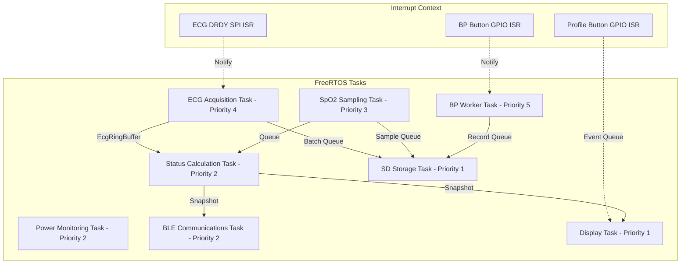

# System Architecture — Patient Monitor

## 1. Overview

The Patient Monitor firmware is designed for the **SparkFun Pro nRF52840 Mini** (Nordic nRF52840 SoC) operating on the **Adafruit nRF52 Arduino Core** with FreeRTOS. It employs a modular C++ architecture where each hardware resource is owned by a single task or managed by an explicit arbitrator.

## 2. FreeRTOS Task Architecture

The system executes exactly **seven scheduled application tasks** plus **one event-driven high-priority Blood Pressure (BP) worker task**:

### Task Responsibilities and Cadences

1. **BP Worker (Priority 5, highest application):** Event-driven, blocked on notification from the BP button ISR. Coordinates exclusive mode with `ModeCoordinator`, checks safety interlocks, executes the cuff state machine, and releases pressure immediately on any fault.
2. **ECG Task (Priority 4):** Continuous SPI acquisition triggered by DRDY notification. Uses a bounded single-producer single-consumer circular buffer (`EcgRingBuffer`) with explicit overrun loss tracking.
3. **SpO₂ Task (Priority 3):** Periodic optical acquisition (25 Hz) measuring raw red/IR channels and signal quality index.
4. **Status Task (Priority 2):** Periodic calculation (500 ms) deriving nonclinical prototype metrics (heart rate, SpO₂%, BP) with valid/stale flags.
5. **Power Task (Priority 2):** Periodic battery voltage polling (1000 ms), reporting battery levels and tripping `battery_critical` when voltage drops below 3.3V.
6. **BLE Task (Priority 2):** Outbound transmission of non-identifiable status snapshots and authenticated commands.
7. **Display Task (Priority 1):** Dedicated owner of display SPI transactions, rendering the current snapshot and demographic profile UI. Safely deferred during BP exclusive mode.
8. **SD Task (Priority 1):** Sole owner of filesystem offsets and directory handles. Writes versioned binary records with CRC32 verification.

## 3. Resource Ownership Invariants

- **SPI Bus Arbitration:** Display, ECG, and SD Card share the SPI controller via `ISpiBus::lock()` / `unlock()`. No task holds the SPI mutex across sleeps or blocking waits.
- **Actuator Exclusivity:** Only the BP subsystem interacts with cuff valves and the pump motor.
- **Filesystem Exclusivity:** Only the SD storage task interacts with SD card files and writes.
