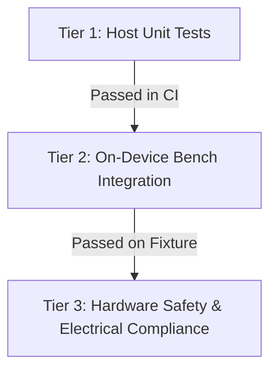

# Test Plan & Verification Strategy

## 1. Test Levels

The verification strategy divides tests into three distinct tiers:

### Tier 1: Host Unit Tests (Executed via `make test`)
Run entirely on developer workstations and CI runners using standard C++17 (`g++` / `clang++`). No physical board required.
- **`test_mode_coordinator`:** Validates valid and invalid mode transitions, exclusive mode flags, and error trip deflation.
- **`test_ecg_ring_buffer`:** Validates FIFO ordering, bounded wrap-around, and explicit overrun loss counters.
- **`test_spo2_task`:** Validates synthetic sample generation and sequence counters.
- **`test_status_task`:** Validates metric validity flags, stale data handling, and confidence thresholds.
- **`test_bp_safety_invariants`:** Validates fail-safe pump off and valve open states upon initialization, error trips, and hardware faults.
- **`test_profile_map`:** Validates demographic metadata schema, strings, and enum cycling.
- **`test_profile_button_controller`:** Validates debounced UI state machine transitions (`VIEW` -> `EDIT_FIELD` -> `SELECT_OPTION` -> `CONFIRM`).
- **`test_sd_task_session_isolation`:** Validates multi-patient session isolation and rejection of misattributed batches.
- **`test_power_task`:** Validates battery voltage thresholds and critical low alerts.

### Tier 2: On-Device Bench Integration (Real Hardware Required)
- Task creation check: verify all 8 tasks created and measure stack high-water marks.
- Measure ECG frame loss at 500 Hz during concurrent SPI display redraws and SD writes.
- Measure worst-case SD write latency and verify ring buffer buffering capacity.
- Exercise simulated pressure sensor load before cuff connection.

### Tier 3: Electrical Safety & Actuator Validation
- Compliance evaluation with IEC 60601-1.
- Physical testing of pneumatic independent relief valve.
- Power failure deflation response time verification.
